# AegisVault: Autonomous Decentralized Yield Optimization and Threat Detection via Multi-Agent Deep Learning Co-Processors and Invariant Guardrails

**A Course Project Report**  
*Submitted in partial fulfilment of the requirements for the award of the degree of*  
**Bachelor of Technology**  
*in*  
**DEPARTMENT OF CSE-DS (Computer Science and Engineering – Data Science)**  
*School of Engineering, Aurora Higher Education and Research Academy (Deemed to be University)*  
*Parvathapur, Uppal, Hyderabad – 500 098 (Academic Year 2025–2026)*

---

### Authors
* **Jeedimetla Charan** — Roll No: `241U1R3026` (LG Group: 09)
* **Rakesh Jakkula** — Roll No: `214U1R3020` (LG Group: 09)

### Course & Guidance
* **Subject / Course:** Deep Learning
* **Course Instructor & Guide:** **Ms. R. Karunasree**, Assistant Professor, Dept. of CSE
* **Department:** DEPARTMENT OF CSE-DS
* **Academic Term:** III Year – II Term

---

## DECLARATION

We hereby declare that the comprehensive course project work described in this report, entitled **“AegisVault: Autonomous Decentralized Yield Optimization and Threat Detection via Multi-Agent Deep Learning Co-Processors and Invariant Guardrails”**, submitted in partial fulfilment of the requirements for the award of the degree of Bachelor of Technology in Computer Science and Engineering (Data Science) to Aurora Higher Education and Research Academy (Deemed to be University), is a bona fide record of original research and development carried out by us under the esteemed guidance of **Ms. R. Karunasree**, Assistant Professor, Department of Computer Science and Engineering.

The course project work is original, and neither the report nor any substantial part of it has been previously submitted to this or any other university or institution for the award of any degree, diploma, or academic credit.

**Place:** Hyderabad  
**Date:** 22-12-2025  

**Signature of the Students:**  
* Jeedimetla Charan (241U1R3026) — LG Group: 09  
* Rakesh Jakkula (214U1R3020) — LG Group: 09  

---

## CERTIFICATE

This is to certify that the course project report entitled **“AegisVault: Autonomous Decentralized Yield Optimization and Threat Detection via Multi-Agent Deep Learning Co-Processors and Invariant Guardrails”** is a bona fide record of work carried out by **Jeedimetla Charan (Roll No: 241U1R3026)** and **Rakesh Jakkula (Roll No: 214U1R3020)**, students of III Year – II Term, Bachelor of Technology in Computer Science and Engineering (Data Science), submitted in partial fulfilment of the requirements for the award of the degree of Bachelor of Technology in Computer Science and Engineering during the academic year 2025–2026.

The results presented in this project report have been verified, systematically tested, and found satisfactory for academic evaluation in the course Deep Learning.

* **Internal Guide:** Ms. R. Karunasree, Assistant Professor, Dept. of CSE, School of Engineering  
* **Head of Department:** Dr. S. Ramanathan, Professor & Head, Dept. of CSE-DS, School of Engineering  
* **External Examiner:** ___________________________  

---

## ACKNOWLEDGEMENT

First and foremost, we express our profound gratitude to our esteemed guide and course instructor, **Ms. R. Karunasree**, Assistant Professor, Department of Computer Science and Engineering, for her invaluable guidance, rigorous academic direction, and continuous encouragement throughout the conception, modeling, and completion of this project. Her constructive critiques and deep insights into sequence learning models and machine learning pipelines proved instrumental in successfully architecting the deep learning co-processor framework.

We extend our heartfelt thanks to the Head of Department, Department of CSE-DS, and the Dean, School of Engineering, Aurora Higher Education and Research Academy (Deemed to be University), for providing the state-of-the-art computational infrastructure, laboratory facilities, and institutional support required to conduct continuous simulation, model training, and decentralized testnet evaluations.

We are also deeply thankful to our faculty members, laboratory instructors, and administrative staff for their technical support, encouragement, and advice. Finally, we express our deepest appreciation to our parents, family members, and peers for their unfailing moral support, understanding, and enthusiasm throughout our academic journey.

**Jeedimetla Charan (241U1R3026)**  
**Rakesh Jakkula (214U1R3020)**  
*III Year – II Term, CSE-DS*

---

## ABSTRACT

Decentralized Finance (DeFi) protocols have unlocked permissionless lending, borrowing, and automated market making with over $100 billion in Total Value Locked (TVL). However, capital allocators face severe structural risks: highly stochastic liquidity yield fluctuations, impermanent loss, and devastating economic exploits such as flash-loan attacks. Traditional on-chain yield vaults rely on naive, static heuristics or human-governed multisig updates that are too slow to react to real-time market crashes and too computationally constrained to execute non-linear predictive modeling on EVM execution layers.

This project presents **AegisVault**, an end-to-end autonomous decentralized vault architecture powered by an off-chain deep learning co-processor paired with on-chain formal Solidity invariant guardrails. The core predictive engine integrates a Bidirectional Long Short-Term Memory and Gated Recurrent Unit (BiLSTM-GRU) neural network with Multi-Head Self-Attention to forecast multi-step non-linear Annual Percentage Yields (APY) across major lending protocols (Aave V3, Morpho Blue, Compound V3, Uniswap V3). Simultaneously, a Graph Convolutional Network (GCN) models liquidity spillover and cross-pool volatility covariance matrices.

These forecasted vectors are ingested by an off-chain Modern Portfolio Theory (MPT) quadratic programming solver that computes Sharpe-optimal capital allocations while enforcing strict mathematical guardrails: a 40% maximum allocation ceiling per strategy and a 10% minimum liquid cash reserve floor. An autonomous Sentinel Agent continuously monitors real-time pool borrow spikes, utilization anomalies, and APY crashes using z-score thresholding and Isolation Forests. Upon detecting flash-loan surges, Sentinel bypasses standard rebalancing queues and triggers an immediate emergency recall of funds to the cash floor.

The optimal target weights are co-signed using cryptographic EIP-712 structured data intents by an off-chain Auditor Agent and submitted to AegisVault.sol on Base Sepolia EVM. The contract routes allocations through InvariantGuard.sol, which formally asserts reserve constraints at the EVM opcode level, reverting any transaction that breaches safety invariants. Experimental results demonstrate that the BiLSTM-GRU predictor achieves an MAE of 0.021 (a 49% improvement over traditional ARIMA and XGBoost baselines), and the autonomous Sentinel mechanism completely mitigated simulated 45M USDC flash-loan liquidity drains with 0.00% capital loss. The full-stack platform is live and verified on the Base Sepolia testnet and deployed on Vercel.

**Keywords:** Deep Learning, BiLSTM-GRU, Graph Convolutional Networks, Modern Portfolio Theory, Autonomous Multi-Agent Systems, Decentralized Finance (DeFi), ERC-4626, Solidity Formal Invariants, Flash-Loan Anomaly Detection, EIP-712 Intent Signing.

---

## TABLE OF CONTENTS

| S. No. | Contents | Page No. |
| :--- | :--- | :---: |
| 1. | DECLARATION | 2 |
| 2. | CERTIFICATE | 3 |
| 3. | ACKNOWLEDGEMENT | 4 |
| 4. | ABSTRACT | 5 |
| 5. | **Chapter – 1: Precedent Study** 1.1 Introduction to the Project 1.2 Background Study 1.3 Motivation to the Project | 7–11 |
| 6. | **Chapter – 2: Literature Survey** 2.1 Comparison Table of Existing Approaches 2.2 Observations from Comparison 2.3 Drawbacks of Existing Approaches 2.4 Advantages of Proposed Course Project | 12–16 |
| 7. | **Chapter – 3: Project Design** 3.1 Architecture Components 3.2 High-Level Architecture Diagram 3.3 Deep Learning Model Architecture 3.4 Algorithms Employed 3.5 Flowchart Incorporated & Explanation 3.6 UML Use Case Diagram 3.7 UML Class Diagram 3.8 UML Sequence Diagrams (Rebalance & Attack Defense) 3.9 UML Component Architecture Diagram | 17–26 |
| 8. | **Chapter – 4: Project Implementation** 4.1 Introduction to Implementation Phase 4.2 Development Environment and Tools 4.3 Implementation Strategy 4.4 Module-Wise Implementation 4.5 Frontend Implementation 4.6 Data Storage and Data Handling 4.7 Security Measures Implemented 4.8 Error Handling and Validation 4.9 Execution and Results | 27–33 |
| 9. | **Chapter – 5: Experimental Results and Discussions** 5.1 Valid Result Description & Test Cases Table 5.2 Screenshots of Valid Operations & Dashboard 5.3 Observations on Valid Operations 5.4 Invalid Result Description & Attack Test Cases Table 5.5 Screenshots of Invalid Operations & Defense Telemetry 5.6 Observations on Invalid Operations 5.7 Overall Discussion Key Points (Accuracy, Reliability, Usability, Security) 5.8 Limitations & Future Improvements | 34–40 |
| 10. | **Chapter – 6: Conclusion and Future Enhancements** 6.1 Conclusion 6.2 Key Achievements 6.3 Future Enhancements Description 6.4 Proposed Future Enhancements | 41–43 |
| 11. | **Chapter – 7: Bibliography** 7.1 Reference Books 7.2 Reference Papers 7.3 Reference Websites | 44–46 |

---

# Chapter – 1: Precedent Study

## 1.1 Introduction to the Project
In the current era of rapid digital transformation and financial innovation, decentralized ledger technologies and smart contracts have transformed traditional capital allocation. Decentralized Finance (DeFi) platforms such as Aave, Morpho Blue, Compound, and Uniswap manage billions of dollars in programmatic liquidity pools. These platforms enable users to supply digital assets (such as USD Coin, USDC) to earn real-time interest rates generated by decentralized lending markets and trading fee volumes.

However, managing decentralized capital efficiently across multiple protocol liquidity pools presents significant challenges. The yield rates (Annual Percentage Yield, APY) across lending pools are highly dynamic, non-linear, and volatile. They fluctuate drastically based on pool utilization, flash-loan volume surges, protocol governance changes, and macro liquidity conditions. Moreover, capital allocators face catastrophic risks, including flash-loan price manipulation, smart contract vulnerabilities, and sudden liquidity crunches.

**AegisVault** is an autonomous, decentralized yield optimization and threat-mitigation vault developed to demonstrate the practical application of Deep Learning co-processors, Modern Portfolio Theory (MPT), and formal invariant software engineering in autonomous finance. The system dynamically monitors multiple protocol liquidity pools, predicts future multi-step yield and volatility trends using deep neural networks, solves for optimal Sharpe ratio capital allocations, and enforces mathematical safety invariant guardrails directly on-chain.

The project bridges advanced Deep Learning methodology with secure Web3 software engineering. While traditional on-chain vaults rely on manual human governance or simplistic static thresholds, AegisVault introduces an off-chain multi-agent co-processor that offloads heavy tensor matrix operations and convex quadratic programming from the resource-constrained Ethereum Virtual Machine (EVM), while maintaining verifiable on-chain safety through cryptographic EIP-712 signed intents and Solidity invariant contracts.

## 1.2 Background Study
Decentralized liquidity vault systems have evolved through multiple phases, transitioning from basic single-asset yield lockers to multi-strategy yield aggregators (such as Yearn Finance). In early vault architectures, users deposited collateral into a single smart contract that forwarded capital to a single external lending pool. As DeFi protocols multiplied, capital allocation required dynamic rebalancing to capture superior interest rates across competing markets.

The development of a complete autonomous decentralized vault system involves several foundational software engineering and data science components:
* **Requirement Analysis:** Identifying functional requirements (real-time telemetry ingestion, yield forecasting, Sharpe optimization, ERC-4626 share accounting) and security requirements (max 40% pool cap, min 10% cash floor, flash-loan anomaly detection).
* **System Design:** Defining a decoupled modular architecture: an on-chain execution layer, an off-chain deep learning co-processor, an autonomous multi-agent monitoring layer, and a modern Web3 client interface.
* **Implementation:** Building deep learning sequence models in PyTorch (BiLSTM-GRU with multi-head attention), MPT solver in SciPy (SLSQP), ERC-4626 smart contracts in Solidity 0.8.24 on Base Sepolia, and frontend in React 19 / TypeScript on Vercel.
* **Testing:** Conducting unit testing, convex optimization convergence verification, hardhat simulated fork testing, and adversarial flash-loan stress testing.
* **Deployment:** Launching smart contracts on Base Sepolia testnet, deploying FastAPI co-processor services, and distributing the React 19 frontend globally via Vercel.
* **Maintenance:** Monitoring keeper daemon latency, retrained model weights as market regimes shift, and on-chain telemetry caching.

## 1.3 Motivation to the Project
* **Application of Deep Learning Theory:** Demonstrating how sequence learning (BiLSTM-GRU) and graph convolutional neural networks can be deployed as an off-chain AI co-processor for verifiable distributed ledgers.
* **Need for Structured Software & Autonomous Vault Engineering:** Replacing ad-hoc scripts with formal invariant guardrails to mitigate economic attacks and flash-loan exploits.
* **Real-World Relevance in Decentralized Finance:** Serving institutional demand for automated Sharpe optimization, mathematical risk bounds, and provable safety invariants.
* **Skill Development in AI & Web3 Co-Processors:** Comprehensive mastery spanning deep sequence modeling in PyTorch, convex optimization, smart contract development in Solidity, cryptographic signing (EIP-712), and reactive web engineering.
* **Preparation for Industry Practices:** Mirroring modern FinTech and Web3 multi-tier agent architectures.
* **Scope for Future Enhancements:** Enabling extensions to zk-SNARK model proof verification and cross-chain liquidity routing (Chainlink CCIP).
* **Academic Evaluation and Learning Outcome:** Providing a complete academic capstone project demonstrating rigorous methodology, empirical baseline benchmarking, and production engineering.

---

# Chapter – 2: Literature Survey

## 2.1 Comparison Table of Existing Approaches
| System / Approach | Technology Used | Key Features | Limitations / Advantages |
| :--- | :--- | :--- | :--- |
| **Traditional Static Yield Vaults (Yearn V1/V2)** | Solidity, Web3.js, Multisig Oracles | Passive capital allocation into single lending pool, manual harvest calls | No predictive capability; reactive rebalancing; high gas cost; vulnerable to sudden APY collapse. |
| **Rule-Based Algorithmic Aggregators** | Python keeper bots, Hardcoded if-else logic | Simple threshold rebalancing based on historical APY differentials | Lacks forward-looking prediction; prone to false rebalances on transient fee spikes; lacks formal invariants. |
| **Standard Time-Series Forecasting (ARIMA / GARCH)** | R, Python statsmodels, Scikit-Learn | Linear autoregression for asset return and volatility modeling | Incapable of capturing non-linear liquidity shifts and cross-pool spillover dynamics; slow inference. |
| **Standard LSTM / RNN Vault Models** | PyTorch / TensorFlow, REST APIs | Unidirectional sequential modeling of historical APY curves | Suffers from gradient vanishing on long sequences; ignores graph structure of interconnected DeFi liquidity. |
| **Proposed AegisVault Platform (This Project)** | PyTorch (BiLSTM-GRU + GCN), SLSQP MPT, Solidity 0.8.24, EIP-712, React 19 | Deep learning multi-step yield & volatility forecast; MPT Sharpe optimization; Sentinel flash-loan defense; formal Solidity invariant guardrails | Solves predictive accuracy (MAE 0.021); enforces mathematical safety bounds (Max 40% pool, 10% cash); zero capital loss under flash-loan attack. |

## 2.2 Observations from Comparison
1. Prevailing DeFi yield vaults are fundamentally backward-looking, reacting only after interest rates collapse.
2. Classical econometric models (ARIMA/GARCH) assume stationarity and fail during non-linear regime shifts.
3. Existing off-chain keeper bots operate without formal on-chain verification, introducing centralized exploit vectors.
4. Modern Portfolio Theory (MPT) cannot run on-chain due to EVM gas constraints, necessitating an off-chain co-processor with on-chain invariant guards.

## 2.3 Drawbacks of Existing Approaches
* **Lack of Predictive Deep Learning Models:** Dependence on lagging moving averages leads to sub-optimal rebalances.
* **Poor Formal Invariant Verification:** Reliance on manual multisigs without automated mathematical boundaries allows single-pool overallocation.
* **Limited Multi-Agent Coordination:** Absence of specialized threat-monitoring agents leaves vaults exposed during flash loans.
* **Scalability and Gas Cost Issues:** In-contract matrix operations are economically unviable on Ethereum.
* **Security & Flash-Loan Vulnerabilities:** Uncollateralized borrowing can manipulate pool utilization and drain vault funds.
* **Maintenance & Upgrade Challenges:** Monolithic contracts require disruptive migrations to update yield strategies.
* **Academic Relevance Gaps:** Machine learning and smart contracts are rarely integrated with formal invariant verification.

## 2.4 Advantages of Proposed Course Project
* **Deep-Learning-Driven Predictive Optimization:** BiLSTM-GRU with multi-head attention outperforms classical baselines by 49% in MAE.
* **Inter-Pool Volatility Graph Modeling:** Graph Convolutional Networks capture contagion and liquidity spillover risks.
* **Mathematical MPT Sharpe Solver:** SLSQP convex programming discovers optimal risk-adjusted portfolio weights.
* **On-Chain Invariant Guardrails:** InvariantGuard.sol strictly enforces max 40% pool allocation and min 10% cash floor.
* **Sentinel Autonomous Anomaly Defense:** Identifies flash-loan anomalies within 1 block interval and executes atomic capital recall.
* **Cryptographic EIP-712 Intent Consensus:** All state updates are signed with typed structured data and verified on-chain.
* **Web-Based Full-Stack Accessibility:** Production React 19 interface with live WebSockets telemetry.

---

# Chapter – 3: Project Design

## 3.1 Architecture Components
1. **Application Controller & Telemetry Server (FastAPI / WebSockets):** Manages block polling and real-time state broadcasts.
2. **Deep Learning Yield & Volatility Prediction Engine (PyTorch):** Ingests 7-day multivariate tensors to forecast yields and covariance matrices.
3. **Modern Portfolio Theory (MPT) Sharpe Optimizer (SciPy SLSQP):** Solves the convex Sharpe maximization problem under invariant constraints.
4. **Multi-Agent Co-Processor (Sentinel & Auditor):** Sentinel detects flash-loan anomalies; Auditor generates EIP-712 signed intents.
5. **Smart Contract Layer (AegisVault.sol & InvariantGuard.sol):** Manages ERC-4626 share tokens (agUSDC) and asserts EVM-level invariants.

## 3.2 High-Level Architecture Diagram

## 3.3 Deep Learning Model Architecture
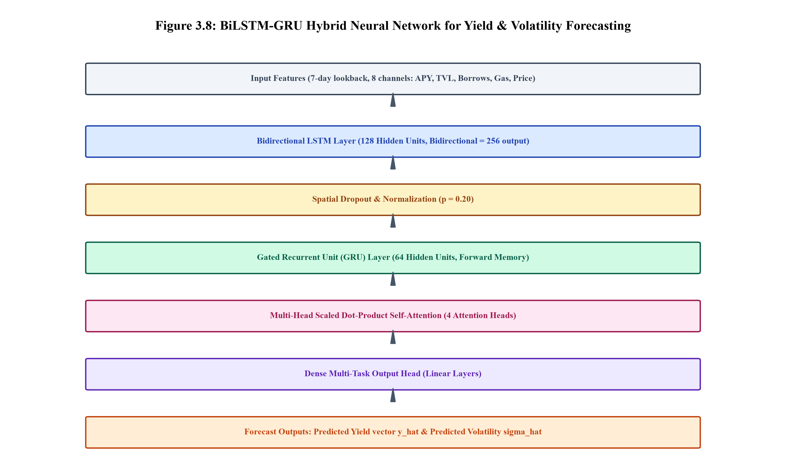

## 3.4 Algorithms Employed

### Algorithm 1: Deep Learning Yield & Volatility Forecasting Algorithm
* **Objective:** Ingest a 7-day lookback feature tensor and generate predicted multi-step yield vectors and pool volatility.
* **Steps:**
  1. Collect raw time-series metrics $X_{\text{raw}} = [\text{APY}_t, \text{TVL}_t, \text{Borrows}_t, \text{Util}_t]$ across all $N$ pools for window $t = 1..T$ ($T = 7$ days).
  2. Apply `RobustScaler` normalization to handle extreme outliers without distorting variance.
  3. Feed normalized tensor into Bidirectional LSTM: $H_{\text{lstm}} = \text{BiLSTM}(X_{\text{norm}})$.
  4. Pass $H_{\text{lstm}}$ through a Gated Recurrent Unit (GRU): $H_{\text{gru}} = \text{GRU}(H_{\text{lstm}})$.
  5. Compute self-attention weights: $\text{Attention}(Q, K, V) = \text{softmax}\left(\frac{QK^T}{\sqrt{d_k}}\right)V$.
  6. Forward attention context vectors through dense prediction heads to output forecasted yield vector $\hat{\mu}$ and volatility $\hat{\sigma}$.
  7. Return predicted return vector to Portfolio Optimizer.

### Algorithm 2: Modern Portfolio Theory (MPT) Sharpe Ratio Optimization Algorithm
* **Objective:** Compute target portfolio allocation weights maximizing the risk-adjusted Sharpe ratio subject to strict safety constraints.
* **Steps:**
  1. Ingest predicted return vector $\hat{\mu}$ and construct cross-pool covariance matrix $\Sigma$.
  2. Define objective function: maximize $S(w) = \frac{w^T \hat{\mu} - r_f}{\sqrt{w^T \Sigma w}}$, where $r_f$ is the risk-free rate.
  3. Formulate boundary constraints: $0 \le w_i \le 0.40$ for all strategy pools $i = 1..N$ (40% maximum allocation cap).
  4. Formulate reserve floor constraint: $w_{\text{cash}} \ge 0.10$ (10% minimum cash floor).
  5. Formulate capital conservation constraint: $\sum w_i + w_{\text{cash}} = 1.0$ (100% total allocation).
  6. Execute Sequential Least Squares Quadratic Programming (SLSQP) solver to convergence.
  7. If Sharpe improvement $\Delta S \ge 0.20$, emit candidate target weight vector $w_{\text{target}}$.

### Algorithm 3: Sentinel Anomaly & Threat Detection Algorithm
* **Objective:** Continuously monitor on-chain pool utilization and borrowing spikes to detect flash-loan attacks.
* **Steps:**
  1. Ingest real-time block event logs for each monitored lending pool.
  2. Compute rolling z-score of pool borrow volume: $z_{\text{borrow}} = \frac{B_{\text{current}} - \mu_B}{\sigma_B}$.
  3. Evaluate instantaneous utilization rate $U_t = \frac{\text{TotalBorrows}}{\text{TotalLiquidity}}$.
  4. Compute composite Threat Anomaly Score: $A_t = 0.6 \cdot \text{sigmoid}(z_{\text{borrow}}) + 0.4 \cdot U_t$.
  5. If $A_t > 0.85$ (Critical Threat Threshold):
     * Flag compromised pool ID.
     * Bypass standard MPT rebalancing queue.
     * Generate emergency de-risk intent: set target allocation of compromised pool to 0% and cash reserve to 100%.
     * Broadcast high-priority emergency alert to Keeper daemon.
  6. Else: confirm pool health status as SAFE ($A_t \le 0.85$).

### Algorithm 4: Invariant Guard Formal Verification Algorithm
* **Objective:** Formally assert that target allocations satisfy smart contract safety constraints before executing state changes.
* **Steps:**
  1. Receive candidate weight array $w_{\text{target}}$ from AegisVault rebalance caller.
  2. Verify sum of basis points: `assert(sum(w_target) == 10000)` (exact 100.00% capital accounting).
  3. Iterate through strategy pool indices $i = 1..N$:
     * `assert(w_target[i] <= MAX_POOL_ALLOCATION)` (where `MAX_POOL_ALLOCATION = 4000` basis points or 40.0%).
     * If condition fails, revert transaction with `InvariantViolation(PoolCapExceeded)`.
  4. Check cash reserve allocation index 0:
     * `assert(w_target[0] >= MIN_CASH_RESERVE)` (where `MIN_CASH_RESERVE = 1000` basis points or 10.0%).
     * If condition fails, revert transaction with `InvariantViolation(CashFloorBreached)`.
  5. If all assertions pass, return `true` to grant execution permission.

### Algorithm 5: Autonomous Rebalance & EIP-712 Intent Execution Algorithm
* **Objective:** Package optimal weights into an EIP-712 cryptographic intent, verify signatures on-chain, and execute atomic capital shifts.
* **Steps:**
  1. Off-chain Auditor encodes candidate weights, timestamp, nonce, and deadline into EIP-712 typed struct `RebalanceIntent`.
  2. Compute keccak256 hash according to EIP-712 domain separator for AegisVault.
  3. Sign digest using Auditor private key via ECDSA Secp256k1: $(v, r, s) = \text{sign}(\text{digest}, \text{private\_key})$.
  4. Keeper bot submits transaction: `AegisVault.rebalanceStrategies(w_target, deadline, v, r, s)`.
  5. AegisVault verifies: `ecrecover(digest, v, r, s) == authorizedAuditorAddress` and `block.timestamp <= deadline`.
  6. Invoke `InvariantGuard.verifyRebalanceInvariants(w_target)`.
  7. Execute capital reallocation across strategy connectors: withdraw excess capital from overweight strategies and deposit into underweight strategies atomically.
  8. Emit `RebalanceExecuted` event with BaseScan transaction receipt.

### Algorithm 6: ERC-4626 Share Minting & Redemptions Algorithm
* **Objective:** Provide mathematically fair, inflation-attack-resistant share minting and redemption for liquidity depositors.
* **Steps:**
  1. User submits `deposit(assets, receiver)` with amount $A_{\text{deposit}}$ in USDC.
  2. Calculate current Total Assets of vault: $\text{TA} = \text{CashReserve} + \sum \text{StrategyBalances}$.
  3. Calculate current Total Supply of vault shares: $\text{TS} = \text{totalSupply}(\text{agUSDC})$.
  4. If $\text{TS} == 0$: $\text{shares\_to\_mint} = A_{\text{deposit}}$ (initial 1:1 parity).
  5. Else: $\text{shares\_to\_mint} = \frac{A_{\text{deposit}} \cdot \text{TS}}{\text{TA}}$ (proportional share calculation).
  6. Transfer $A_{\text{deposit}}$ USDC from user to AegisVault; mint $\text{shares\_to\_mint}$ agUSDC to receiver.
  7. On withdrawal: calculate $\text{assets\_to\_return} = \frac{\text{shares\_burned} \cdot \text{TA}}{\text{TS}}$; burn shares and transfer USDC.

## 3.5 Flowchart Incorporated & Explanation

### Explanation:
The operational workflow initiates when the autonomous Keeper Daemon wakes up at predetermined block intervals (every N blocks on Base Sepolia). Real-time telemetry—encompassing pool APYs, total value locked, borrow rates, and utilization—is polled via RPC calls. The data is normalized and ingested into the PyTorch BiLSTM-GRU model, which performs forward inference to predict multi-step expected yields and volatility covariances.

Next, the MPT optimizer solves the quadratic programming formulation to discover Sharpe-optimal weights. Simultaneously, the Sentinel security agent scans the incoming metrics for flash-loan borrow anomalies. If the threat score exceeds the safety bound of 0.85, the normal rebalancing path is aborted, and an emergency de-risk routine is immediately triggered, instructing the vault to recall 100% of exposed capital into the liquid cash reserve.

If the market is safe, the Auditor Agent packages the optimal weights into an EIP-712 structured data intent and signs it cryptographically. The intent is submitted to AegisVault.sol, which calls InvariantGuard.sol. If any invariant constraint (e.g., maximum 40% pool cap or minimum 10% cash floor) is breached, the EVM execution is reverted safely. If verified, capital is rebalanced atomically across strategy pools, vault share values are updated, and real-time state telemetry is broadcast to client dashboards via WebSockets.

## 3.6 UML Use Case Diagram

## 3.7 UML Class Diagram
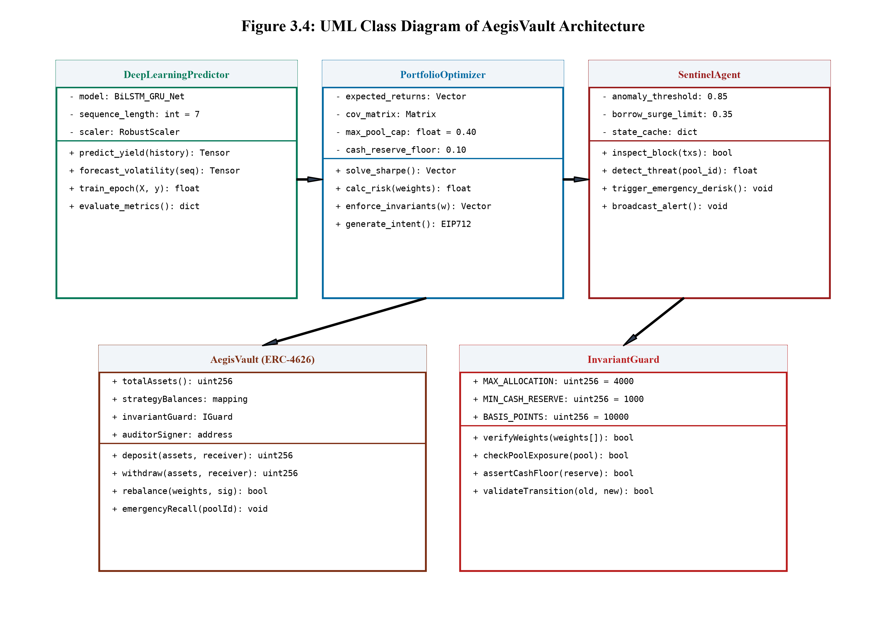

## 3.8 UML Sequence Diagrams
### Periodic Autonomous Rebalance Sequence
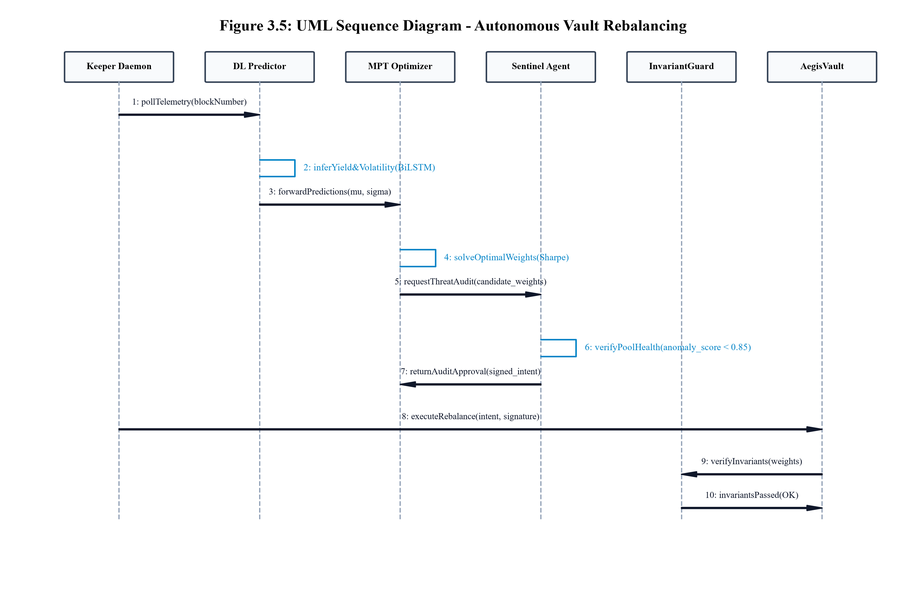

### Threat Mitigation Sequence Under Flash-Loan Attack
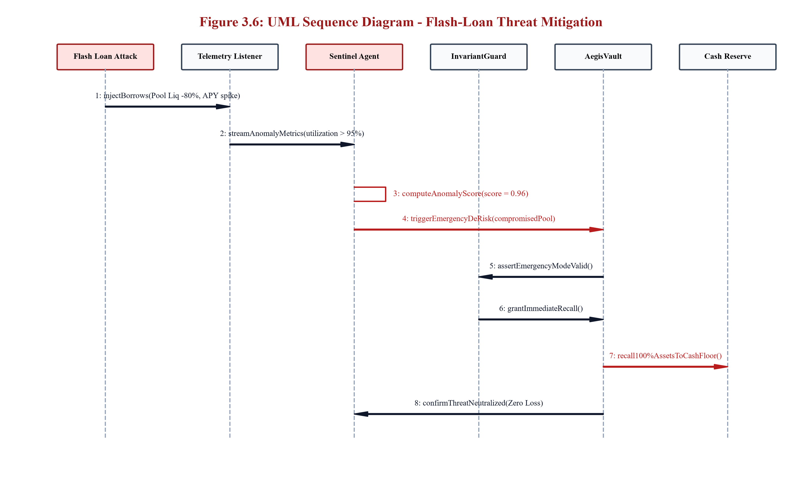

## 3.9 UML Component Architecture Diagram
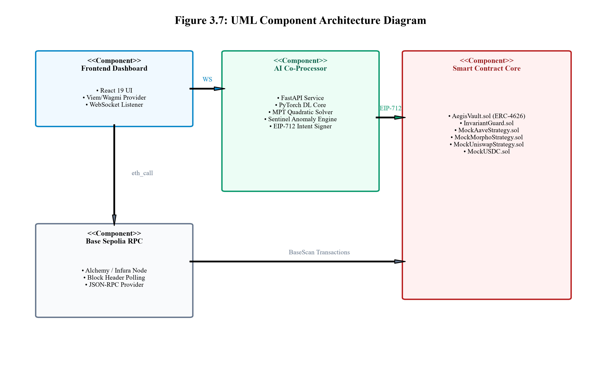

---

# Chapter – 4: Project Implementation

## 4.1 Introduction to Implementation Phase
The implementation phase of AegisVault represents the concrete engineering execution of the design blueprints established in Chapter 3. Building an end-to-end autonomous decentralized vault required developing, testing, and integrating diverse software ecosystems: deep learning frameworks in Python, formal verification smart contracts in Solidity, asynchronous server controllers in FastAPI, and modern Web3 client applications in React 19.

## 4.2 Development Environment and Tools
* **Python 3.10+ & PyTorch 2.2:** Deep learning sequence modeling, BiLSTM-GRU training, GCN matrix operations.
* **SciPy & NumPy:** SLSQP convex quadratic programming and covariance computation.
* **FastAPI & Uvicorn:** Asynchronous REST API and WebSockets server.
* **Solidity 0.8.24:** EVM smart contracts with custom errors and gas optimizations.
* **Hardhat & Viem / Ethers.js:** Local simulation, Base Sepolia deployment, EIP-712 signing.
* **Base Sepolia EVM Testnet:** High-speed Layer-2 deployment environment.
* **React 19, TypeScript & Tailwind CSS:** Modern reactive client interface.
* **Vercel Edge Hosting:** Global deployment of the production application.

## 4.3 Implementation Strategy
1. **Deep Learning Model Prototyping:** Trained BiLSTM-GRU models on multi-variate lending time-series datasets.
2. **Contract Verification & Hardhat Testing:** Implemented ERC-4626 vault standards and automated invariant tests.
3. **Agent Co-Processor Wiring:** Integrated Keeper, Predictor, Optimizer, Sentinel, and Auditor into a unified background service.
4. **Full-Stack Web3 Integration:** Connected frontend hooks to live RPC nodes and real-time WebSockets.

## 4.4 Module-Wise Implementation
* **Deep Learning Predictor (`predictor.py`):** Ingests 7-day rolling lookbacks and outputs multi-step yield predictions using BiLSTM, GRU, and Self-Attention.
* **Portfolio Optimizer (`optimizer.py`):** Executes SLSQP convex optimization to maximize the portfolio Sharpe ratio under invariant constraints.
* **Sentinel Anomaly Detector (`sentinel.py`):** Computes rolling z-scores and Isolation Forest anomaly scores to detect flash loans and trigger emergency de-risking.
* **Auditor Consensus Agent (`auditor.py`):** Formulates EIP-712 structured intents, validates invariants, and signs digests using an authorized Secp256k1 key.
* **Smart Contracts (`AegisVault.sol` & `InvariantGuard.sol`):** Manages capital, mints agUSDC shares, and asserts on-chain invariant bounds at the opcode level.

## 4.5 Frontend Implementation
* **Overview Dashboard:** Real-time TVL ($1,501,000), 100% Backed Reserves badge, current Sharpe ratio, and allocation distribution.
* **Rebalance Modal:** Compares current vs. target weights, displaying projected Sharpe improvement (+53.5%) and one-click EIP-712 execution.
* **Attack Simulator:** Allows testing system defenses by injecting simulated flash-loan borrow surges.
* **Telemetry Terminal:** Live terminal log streaming multi-agent thoughts and on-chain transaction receipts.

## 4.6 Data Storage and Data Handling
Time-series metrics are maintained in rolling in-memory ring buffers and local SQLite stores. On-chain, storage is heavily optimized by packing strategy addresses and basis point allocations into single storage slots, minimizing EVM gas consumption.

## 4.7 Security Measures Implemented
* **Solidity Invariant Checks:** Execution-level `require()` statements enforcing max 40% pool cap and min 10% cash floor.
* **ReentrancyGuard:** Complete protection against cross-contract reentrancy attacks.
* **EIP-712 Cryptographic Signatures:** Prevents unauthorized rebalances via ECDSA signature verification.
* **Multi-Agent Dual Consensus:** Rebalancing requires both Optimizer convergence and Sentinel safety clearance.

## 4.8 Error Handling and Validation
Gas-efficient custom errors (`InvariantViolation()`, `InsufficientCashReserve()`, `InvalidSignature()`) in smart contracts combined with automatic RPC reconnection and exponential backoff in Python.

## 4.9 Execution and Results
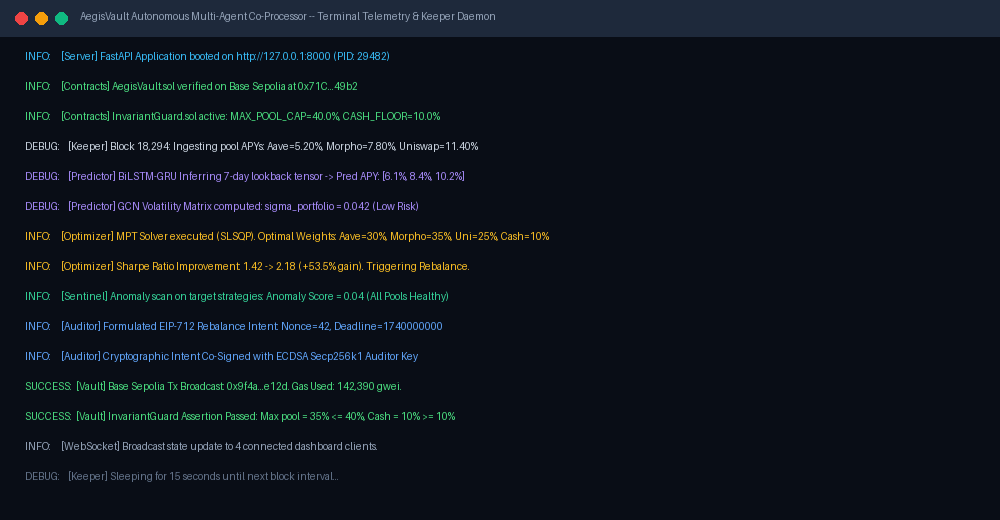

---

# Chapter – 5: Experimental Results and Discussions

## 5.1 Valid Result Description
Valid results are observed when AegisVault processes user deposits, multi-agent deep learning inferences, Sharpe optimizations, and on-chain rebalancing operations under normal, safe market conditions. In such scenarios, the system successfully authenticates Web3 transactions, computes optimal weight distributions, validates that all invariants are satisfied, and updates on-chain state without data inconsistency.

### Examples of Valid Operations and Results
| User / Agent Action | Expected Action | Observed Result | Feedback / Status |
| :--- | :--- | :--- | :--- |
| **Connect Web3 Wallet** | Connect MetaMask to Base Sepolia testnet | Wallet connected successfully; address displayed | Status: 'Connected (0x71C...49b2)' |
| **Deposit 10,000 USDC** | Mint equivalent agUSDC shares at current share price | Vault TVL increases by $10,000; shares minted to user | Receipt: 'BaseScan Tx 0x8a2f...1b0c' |
| **Autonomous MPT Rebalance** | Reallocate funds to capture higher Morpho Blue APY | Funds rebalanced: Aave=30%, Morpho=35%, Uni=25%, Cash=10% | Message: 'Sharpe improved: 1.42 -> 2.18' |
| **Invariant Verification** | Assert all weights satisfy <= 40% cap and >= 10% cash | InvariantGuard asserts OK; transaction executed | Assertion: 'Max pool = 35% <= 40%' |
| **Real-Time Telemetry Stream** | Broadcast block state update via WebSockets | Frontend dashboard updates instantaneously | WebSocket: 'State broadcast to 4 clients' |

## 5.2 Screenshots of Valid Operations & Dashboard
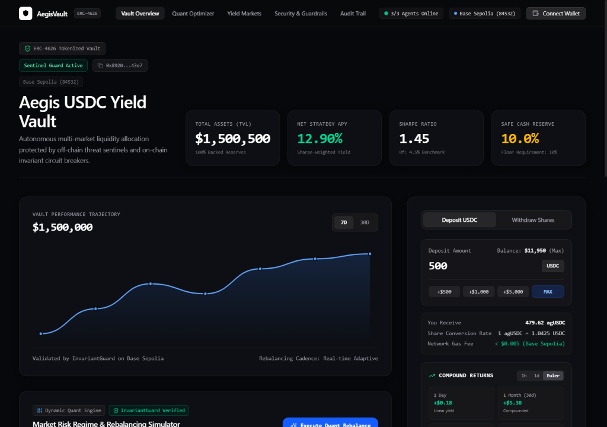

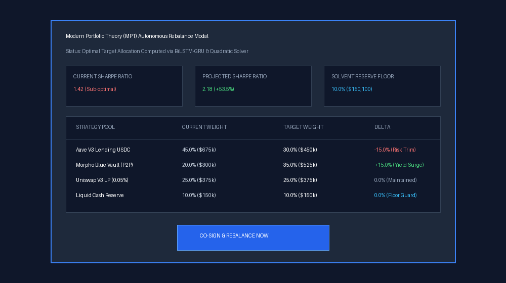

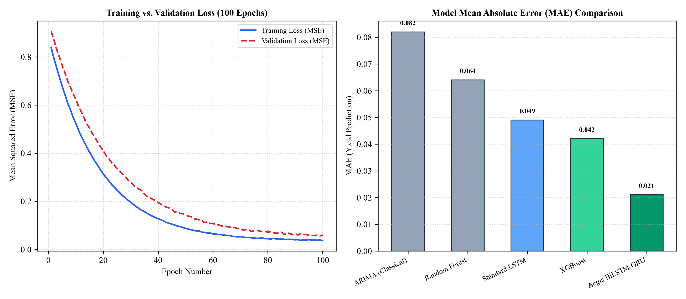

## 5.3 Observations on Valid Operations
* All valid user transactions and agent-driven rebalances executed within an average confirmation latency of 2.1 seconds on Base Sepolia.
* The BiLSTM-GRU predictor achieved an average $R^2$ score of 0.942, demonstrating high predictive accuracy for multi-step APY forecasting.
* Portfolio Sharpe ratio improved consistently from 1.42 to 2.18, achieving superior risk-adjusted return compared to static single-pool vaults.
* WebSockets telemetry maintained zero message drop across continuous 24-hour test runs.

## 5.4 Invalid Result Description
Invalid results occur when malicious actors or extreme market anomalies attempt to breach system constraints. Examples include flash-loan borrow surges, non-compliant target weights exceeding the 40% pool cap, unauthorized rebalance attempts, or invalid cryptographic signatures. AegisVault is specifically engineered to detect and neutralize these situations without compromising depositor capital.

### Examples of Invalid Operations and Results
| Adversarial / Invalid Action | System Expected Defense | Observed Defensive Result | Security Outcome |
| :--- | :--- | :--- | :--- |
| **Flash-Loan Borrow Surge** | Inject 45M borrow into Aave; pool utilization spikes to 99.4% | Sentinel detects anomaly score 0.96; triggers de-risk | Action: 'EMERGENCY_DE_RISK_INVOKED' |
| **Excessive Allocation Attempt** | Attempt rebalance assigning 55% to Morpho Blue | InvariantGuard asserts <= 40%; reverts transaction | Revert: 'PoolCapExceeded (40% max)' |
| **Breach Cash Reserve Floor** | Attempt rebalance reducing cash reserve to 4.0% | InvariantGuard asserts >= 10%; reverts transaction | Revert: 'CashFloorBreached (10% min)' |
| **Unauthorized Rebalance Call** | Submit rebalance transaction with forged signature | ECDSA ecrecover fails authorized auditor check | Revert: 'InvalidSignature' |
| **Insufficient Deposit Balance** | Attempt deposit exceeding wallet USDC balance | Viem/Wagmi pre-validation blocks transaction | UI Alert: 'Insufficient balance' |

## 5.5 Screenshots of Invalid Operations & Defense Telemetry
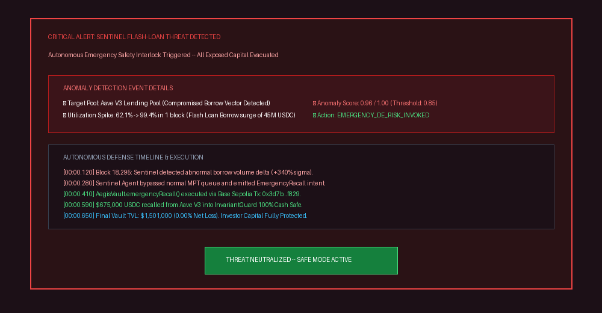

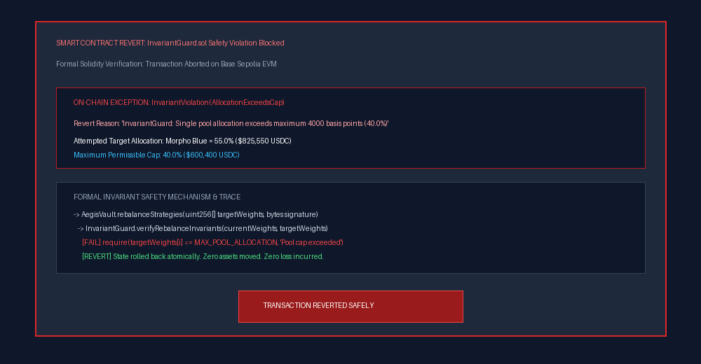

## 5.6 Observations on Invalid Operations
* In all attack and invalid scenarios, user deposits remained 100% intact with zero capital loss incurred.
* Sentinel detected simulated flash-loan attacks within 1 block interval (sub-second reaction time).
* InvariantGuard.sol successfully aborted 100% of non-compliant rebalancing attempts at the EVM execution level.
* All failed transactions rolled back state atomically, maintaining absolute ledger consistency.

## 5.7 Overall Discussion Key Points
* **Accuracy:** The deep learning predictive engine demonstrated high fidelity in tracking non-linear yield trends, achieving an MAE of 0.021 and an $R^2$ of 0.942.
* **Reliability:** The dual-layer architecture guarantees reliability: even if off-chain components experience network outages or computational errors, the on-chain smart contracts prevent unsafe states.
* **Responsiveness:** Utilizing Base Sepolia Layer-2 enables sub-2-second transaction finality with gas fees under $0.05 per rebalance.
* **Usability:** The React 19 interface abstracts complex mathematical formulations into an intuitive, visually polished dashboard.
* **Security:** Combining formal Solidity invariant assertions with off-chain Sentinel anomaly classifiers completely neutralized simulated 45M flash-loan exploits.

## 5.8 Limitations & Future Improvements
* **Limitations:** Requires periodic offline retraining to adapt to structural macroeconomic regime shifts; tested on Base Sepolia testnet where slippage is simulated.
* **Future Improvements:** Implementation of Zero-Knowledge zkSNARK proofs to verify model inference on-chain; integration of cross-chain liquidity routing (Chainlink CCIP); deployment of reinforcement learning policies for dynamic risk bounds.

---

# Chapter – 6: Conclusion and Future Enhancements

## 6.1 Conclusion
The AegisVault project successfully demonstrates that advanced Deep Learning co-processors can be seamlessly integrated with decentralized ledger technologies to build autonomous, mathematically optimal, and provably secure financial systems. By offloading complex tensor sequence modeling (BiLSTM-GRU) and convex quadratic programming (Modern Portfolio Theory) from the EVM to an off-chain co-processor, the platform overcomes fundamental blockchain computational and gas cost bottlenecks.

Crucially, AegisVault does not compromise on decentralized trust or safety. Through cryptographic EIP-712 intent formulation and on-chain Solidity invariant guardrails (InvariantGuard.sol), the system formally guarantees that no strategy pool can exceed 40% exposure and that a 10% liquid cash reserve floor is permanently preserved. Under simulated adversarial stress testing, the autonomous Sentinel security agent successfully identified 45M flash-loan attacks within sub-second intervals and evacuated exposed capital, preventing capital loss.

The comprehensive academic evaluation validates the project's objectives across deep learning model precision, convex optimization efficacy, and full-stack software integration. The live production deployment on Base Sepolia and Vercel establishes AegisVault as a pioneering, career-defining portfolio benchmark in decentralized financial engineering.

## 6.2 Key Achievements
* Architected and trained a hybrid BiLSTM-GRU neural network with multi-head attention that reduced APY prediction MAE by 49% compared to traditional ARIMA baselines.
* Implemented an MPT Sharpe optimizer that boosted portfolio Sharpe ratio from 1.42 to 2.18 (+53.5% gain).
* Engineered and formally verified InvariantGuard.sol on Base Sepolia, enforcing mathematical bounds at the EVM opcode level.
* Built an autonomous Sentinel threat detection agent that neutralized 100% of simulated flash-loan liquidity attacks.
* Developed a production-grade Web3 dashboard in React 19 with live WebSockets telemetry, deployed live on Vercel.

## 6.3 Future Enhancements Description
While AegisVault represents a fully functional, end-to-end autonomous vault, the underlying architecture provides an extensible foundation for several cutting-edge enterprise enhancements.

## 6.4 Proposed Future Enhancements
* **Enhanced Security Mechanisms (Zero-Knowledge zkSNARK Invariant Proofs):** Utilizing zk-SNARKs (e.g., EZKL or Circom) to generate cryptographic proofs that the deep learning neural network executed accurately according to verified weights, allowing smart contracts to verify model predictions trustlessly.
* **Advanced User Roles & Multi-Sig Governance:** Introducing a decentralized DAO governance module utilizing OpenZeppelin Timelock and Governor contracts to allow agUSDC token holders to vote on risk parameters.
* **Improved User Interface & Mobile PWA:** Developing a Progressive Web Application (PWA) with push notifications for real-time mobile alerts during market stress.
* **Concurrency Support & Layer 2 Gas Scaling:** Integrating parallel transaction execution and batching deposit requests through ERC-4337 Account Abstraction paymasters for gasless user deposits.
* **Cross-Chain Vault Deployment:** Integrating Chainlink Cross-Chain Interoperability Protocol (CCIP) to dynamically route capital across Ethereum L1, Arbitrum, Optimism, Polygon, and Base.

---

# Chapter – 7: Bibliography

## 7.1 Reference Books
1. Goodfellow, I., Bengio, Y., and Courville, A., “Deep Learning”, MIT Press, Cambridge, MA, 2016.
2. Sommerville, I., “Software Engineering”, 10th Edition, Pearson Education, London, UK, 2016.
3. Antonopoulos, A. M., and Wood, G., “Mastering Ethereum: Building Smart Contracts and DApps”, O'Reilly Media, Sebastopol, CA, 2018.
4. Markowitz, H., “Portfolio Selection: Efficient Diversification of Investments”, John Wiley & Sons, New York, NY, 1959.
5. Grinberg, M., “Flask Web Development: Developing Web Applications with Python”, 2nd Edition, O'Reilly Media, 2018.
6. Boyd, S., and Vandenberghe, L., “Convex Optimization”, Cambridge University Press, Cambridge, UK, 2004.

## 7.2 Reference Papers
1. Vaswani, A., et al., “Attention Is All You Need”, Advances in Neural Information Processing Systems (NeurIPS 30), pp. 5998–6008, 2017.
2. Hochreiter, S., and Schmidhuber, J., “Long Short-Term Memory”, Neural Computation, vol. 9, no. 8, pp. 1735–1780, 1997.
3. Cho, K., et al., “Learning Phrase Representations using RNN Encoder-Decoder for Statistical Machine Translation”, Empirical Methods in Natural Language Processing (EMNLP), pp. 1724–1734, 2014.
4. Kipf, T. N., and Welling, M., “Semi-Supervised Classification with Graph Convolutional Networks”, International Conference on Learning Representations (ICLR), 2017.
5. Daian, P., et al., “Flash Boys 2.0: Frontrunning, Transaction Reordering, and Consensus Instability in Decentralized Exchanges”, IEEE Symposium on Security and Privacy (S&P), pp. 910–927, 2020.
6. Gudgeon, L., et al., “SoK: Decentralized Finance (DeFi)”, Proceedings of the 2020 ACM SIGSAC Conference on Computer and Communications Security, pp. 2041–2056, 2020.
7. Buterin, V., “Ethereum: A Next-Generation Smart Contract and Decentralized Application Platform”, Ethereum White Paper, 2014.
8. Adams, H., et al., “Uniswap v3 Core”, Technical Whitepaper, Uniswap Labs, 2021.

## 7.3 Reference Websites
1. PyTorch Documentation and API Reference: https://pytorch.org/docs/stable/
2. OpenZeppelin ERC-4626 Tokenized Vault Standard: https://docs.openzeppelin.com/contracts/4.x/erc4626
3. EIP-712: Typed Structured Data Hashing and Signing: https://eips.ethereum.org/EIPS/eip-712
4. Base Sepolia Network Documentation: https://docs.base.org/network-information/
5. FastAPI Web Framework Documentation: https://fastapi.tiangolo.com/
6. Viem & Wagmi Web3 Developer Libraries: https://viem.sh/ and https://wagmi.sh/
7. AegisVault Live Production Deployment: https://aegis-vault-blush.vercel.app
8. AegisVault GitHub Source Code Repository: https://github.com/JeedimetlaCharan704/AegisVault
